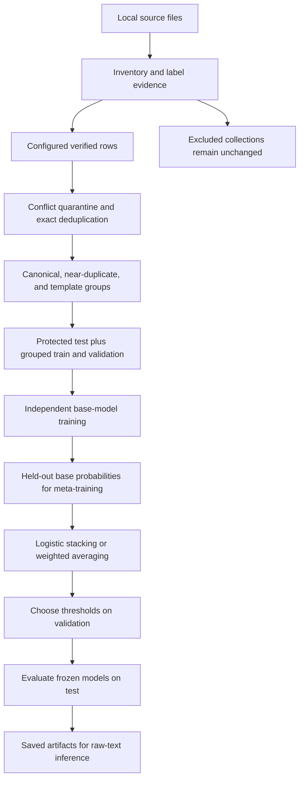

# Dataset Processing and Project Logic

This document explains exactly how each local dataset was treated and how the project's algorithms turn the retained data into predictions. It is a separate technical account of the existing implementation, based on the saved audit and preparation artifacts from 25 October 2026.

For installation and command-by-command execution, use the [Project Guide](PROJECT_GUIDE.md). For measured performance, see the [research results](../reports/research_results.md).

**Execution status:** dataset preparation, real TF-IDF training, and five-fold TF-IDF out-of-fold prediction generation are complete. Transformer and complete ensemble workflows are implemented and integration-tested, but real training has not run because the requested pretrained checkpoints are unavailable. Statements below distinguish completed processing from implemented training logic.

## 1. Data-processing policy

The target classes are `0 = benign` and `1 = prompt injection`. A source label is mapped only when its meaning is established by the source documentation or an unambiguous literal label. A numeric value of `1` is not automatically interpreted as injection.

Every dataset received one of three treatments:

| Treatment | Meaning in this project |
|---|---|
| Admitted | Verified rows enter the canonical prepared dataset and receive split assignments |
| Quarantined | Configured rows are recorded separately because their labels or contents cannot be safely admitted |
| Excluded collection | The collection is inventoried but is not selected for binary training; it does not necessarily appear in the row-level quarantine CSV |

All original files remain unchanged. The integrity report verifies that the SHA-256 hashes of all 11 inventoried files match their recorded hashes. Prepared outputs are written under `data/processed/`.

The code first inventories the files; it does not concatenate everything it finds. Admission is separately controlled by the source definitions in [`configs/default.json`](../configs/default.json).

## 2. Files inspected and initial quality checks

There are six collections containing 11 data files. Relative paths in this table start at `prompt injection dataset/`.

| Collection and file | Rows | Relevant columns | Existing partition |
|---|---:|---|---|
| `prompt_injections/prompt_injections.csv` | 1,034 | `prompt_injections` | Unspecified |
| `memoryInjection/C.A.M.S/dataset-cams.csv` | 80,000 | `query`, `label`, `subcategory`, identifiers and length metadata | Unspecified |
| `prompt-injections-benchmark/data/test-00000-of-00001.parquet` | 5,000 | `text`, `label` | Test |
| `prompt-injections-benchmark/test.csv` | 5,000 | `text`, `label` | Test revision used for auditing |
| `prompt-injection-safety/data/train-00000-of-00001.parquet` | 50,000 | `text`, `label` | Train |
| `prompt-injection-safety/data/test-00000-of-00001.parquet` | 10,000 | `text`, `label` | Test |
| `hugging face/data/train-00000-of-00001-9564e8b05b4757ab.csv` | 546 | `text`, `label` | Train |
| Same training filename with `.parquet` extension | 546 | `text`, `label` | Same train examples |
| `hugging face/data/test-00000-of-00001-701d16158af87368.csv` | 116 | `text`, `label` | Test |
| Same test filename with `.parquet` extension | 116 | `text`, `label` | Same test examples |
| `prompt-injection-attack-dataset/complete_dataset.csv` | 3,747 | Target text/task fields, injection text/task fields, five attack variants | Unspecified |

These row counts must not be summed as independent examples: some files are mirrors and the benchmark files are overlapping revisions.

The inventory checks schemas, null/blank values, complete-row duplicates, repeated texts, text lengths, raw label distributions, within-file conflicts where applicable, and exact text overlap across single-text-column files. **No null or blank values were reported in the inspected columns of these files.** The loader still rejects empty or non-string model inputs if they occur in a future source.

Character lengths illustrate why text length and token truncation matter:

| Text source | Median characters | Maximum characters |
|---|---:|---:|
| `prompt_injections` | 70 | 292 |
| C.A.M.S, all raw queries | 57 | 142 |
| Benchmark, either revision | 614.5 | 11,977 |
| Safety train | 330 | 11,727 |
| Safety test | 328 | 4,510 |
| Small `hugging face` train | 63 | 4,545 |
| Small `hugging face` test | 73.5 | 632 |

Characters are not tokenizer tokens. These measurements do not establish how many examples fit in a Transformer's 256-token default window. The full inventory includes additional character and word-length quantiles and separate statistics for each attack-variant column.

Evidence: [`reports/inventory.json`](../reports/inventory.json).

## 3. Dataset-by-dataset processing

### 3.1 `prompt_injections`: admitted positive-only data

**Input:** `prompt_injections/prompt_injections.csv`.

**Schema:** one text column, `prompt_injections`; there is no row-level binary label column.

**Label decision:** the local README explicitly describes the collection as prompt injection examples. The configured loader therefore assigns the constant label `1`. This is source-level supervision, not a new manual annotation of each example.

**Actual processing:**

1. Read all 1,034 rows without stripping punctuation, case, or payload structure.
2. Assign `label = 1` and retain source/row metadata.
3. Remove 60 exact duplicate texts, retaining their provenance.
4. Keep the remaining 974 distinct texts.
5. Apply the common canonical/near-duplicate grouping procedure.
6. Allocate whole groups to training or validation.

| Outcome | Count |
|---|---:|
| Original rows | 1,034 |
| Exact duplicate rows removed | 60 |
| Retained distinct texts | 974 |
| Duplicate/near-duplicate groups | 963 |
| Training positives | 781 |
| Validation positives | 193 |

The README describes multiple languages, but the rows do not provide verified individual language or attack-family labels. The pipeline does not invent them. This collection supplies all currently admitted positive development examples.

### 3.2 C.A.M.S: partially admitted, with unverified labels quarantined

**Input:** `memoryInjection/C.A.M.S/dataset-cams.csv`.

**Schema:** `query_id`, `query`, `label`, `subcategory`, `query_length`, `word_count`, and `template_seed`.

The model text comes from `query`. The raw class distribution and resulting policy are:

| Original label | Raw rows | Distinct raw query texts | Processing decision |
|---|---:|---:|---|
| `legitimate` | 20,000 | 10,366 | Map to benign `0` |
| `ambiguous` | 20,000 | 19,502 | Quarantine; do not force into either binary class |
| `mextra` | 20,000 | 33 | Quarantine pending documented label semantics |
| `minja` | 20,000 | 18,406 | Quarantine pending documented label semantics |

The names and example contents of `mextra` and `minja` may suggest attack-related uses, but the implementation does not treat that suggestion as verified binary annotation.

**Actual processing:**

1. Read 80,000 rows and inspect label/subcategory distributions.
2. Admit the 20,000 rows carrying the literal `legitimate` label.
3. Record the other 60,000 rows by source, row number, original label, and exclusion reason in `unverified_labels.csv`.
4. Remove 9,634 exact duplicate benign texts, leaving 10,366.
5. Preserve the provided subcategory and original row metadata.
6. Group numeric template variants before splitting.
7. Allocate whole groups to training or validation.

The admitted raw benign subcategories are `standard_lookup` (7,000 rows), `multi_patient_comparison` (6,500), and `conversational_followup` (6,500). These are source-provided categories, not attack labels.

#### Why the numeric-template rule is necessary

These two illustrative strings differ only in a patient number:

```text
Show patient 123456 labs.
Show patient 987654 labs.
```

They are examples of the grouping rule, not newly added dataset rows. For grouping only, numeric spans are replaced with `<NUMBER>` after case/whitespace normalization:

```text
show patient <NUMBER> labs.
```

Both strings would share a group. Their original numbers and original text would remain intact as model input. This prevents a classifier from training on one instance of a template and appearing to generalize when tested on another instance differing only in an identifier.

After the combined grouping rules, the 10,366 retained benign texts occupy only **40 groups**. This is an important limitation: 10,366 rows do not represent 10,366 independent benign patterns.

| Outcome | Count |
|---|---:|
| Raw rows admitted before deduplication | 20,000 |
| Raw rows quarantined | 60,000 |
| Retained distinct benign texts | 10,366 |
| Duplicate/template groups | 40 |
| Training benign examples | 8,468 |
| Validation benign examples | 1,898 |

The full C.A.M.S file has zero complete-row duplicates but 31,693 repeated query texts. Unique IDs and other metadata can make rows different even when the model would see exactly the same query. The pipeline therefore deduplicates by text, not by complete row or `query_id`.

### 3.3 Prompt-injections benchmark: canonical test revision with conflict auditing

**Inputs:** the benchmark Parquet test file and `test.csv`.

**Schema:** `text`, `label`.

**Label decision:** the local README defines `benign` and `jailbreak`. The mappings are:

```text
benign    → 0
jailbreak → 1
```

Jailbreak is a related but broader target than prompt injection. Reported benchmark performance should be interpreted with that distinction in mind.

The two revisions have different raw label counts:

| Revision | Benign | Jailbreak | Total |
|---|---:|---:|---:|
| Parquet | 2,997 | 2,003 | 5,000 |
| CSV | 3,001 | 1,999 | 5,000 |

They share 4,981 exact texts. Each contains 19 texts absent from the other revision. Eight shared texts have contradictory labels: six are positive in Parquet but benign in CSV; two have the reverse disagreement.

**Actual processing:**

1. Select Parquet as the canonical test revision.
2. Load CSV with `audit_only: true` to detect contradictory labels and retain matching provenance.
3. Identify conflicting labels by exact raw-text identity across both revisions.
4. Quarantine all records belonging to those eight texts.
5. Remove all audit-only CSV rows from the pool of admissible examples; CSV-only texts do not enter the dataset.
6. Keep 4,992 canonical Parquet examples exclusively in test.
7. Group canonical/near-duplicate test texts so that their relatedness remains recorded and can be used in grouped analyses.

| Outcome | Count |
|---|---:|
| Canonical Parquet rows | 5,000 |
| Conflicting canonical texts removed | 8 |
| Retained test examples | 4,992 |
| Retained benign / positive | 2,995 / 1,997 |
| Retained test groups | 4,951 |
| Training or validation contribution | 0 |

`label_conflicts.jsonl` contains **16 records**, because each of the eight conflicting texts occurs in both revisions. This is eight disputed examples, not 16 independent examples.

The preparation summary's `audit_only_nonconflicting_rows = 4,992` refers to the CSV after conflict removal. It does not mean that 4,992 CSV rows were added to training or test; all audit-only rows are excluded from canonical admission.

### 3.4 Prompt-injection safety: inspected but excluded

**Inputs:** 50,000-row train Parquet and 10,000-row test Parquet.

**Schema:** `text`, `label`.

| Original value | Train | Test |
|---|---:|---:|
| `0` | 23,414 | 4,557 |
| `1` | 22,586 | 4,443 |
| `2` | 4,000 | 1,000 |

**Reason for exclusion:** the local README lists the schema and partitions but does not establish what all three values mean. The presence of `2` makes a naive binary conversion especially unsafe. Harmful content and prompt injection are also not interchangeable targets.

**Actual actions:** inspect both files, record distributions and lengths, identify seven exact repeated training texts, and detect 800 exact texts shared between the supplied train and test partitions. No within-file exact-text label conflicts or conflicting raw labels among those 800 shared texts were reported.

**Training contribution:** zero. The collection is excluded by the source configuration, rather than converted into 60,000 row-level entries in `unverified_labels.csv`.

There are also 11 exact texts shared between safety training and the canonical benchmark. If this collection is admitted later, verified label semantics and a new global duplicate/split audit are required. Independently trusting each source's train/test filenames would allow contamination.

### 3.5 Small `hugging face` collection: mirrored formats and unverified numeric labels

**Inputs:** train and test supplied in both CSV and Parquet formats.

**Schema:** `text`, `label`.

| Partition | Raw `0` | Raw `1` | Rows per format |
|---|---:|---:|---:|
| Train | 343 | 203 | 546 |
| Test | 56 | 60 | 116 |

The CSV and Parquet versions of each partition contain identical text sets with no label conflicts. They represent 662 examples across train/test, not 1,324 independent examples. No repeated text within either individual partition was reported.

**Reason for exclusion:** the local dataset card does not define the numeric label semantics. Sample inspection also shows ordinary instruction-like text labeled `1`, so treating every `1` as malicious would require unsupported assumptions about the intended task.

**Actual actions:** read all four files, verify the mirrors, inspect labels and lengths, and record cross-source overlap. In particular, 29 texts in this collection's training partition also occur in the benchmark. Additional overlaps with safety are listed in the inventory.

**Training contribution:** zero. No binary mapping was applied. This entire collection is excluded, not silently treated as benign or merged into the other sources.

### 3.6 Prompt-injection attack-task dataset: multiple text roles, no direct detector mapping

**Input:** `prompt-injection-attack-dataset/complete_dataset.csv`, with 3,747 rows.

The schema contains several different kinds of fields:

| Field group | Columns | Interpretation used for the audit |
|---|---|---|
| Target task | `target_text`, `target_label`, `target_task_type` | Original task input and task-specific outcome |
| Injected task | `inject_text`, `inject_label`, `inject_task_type` | Another task input and its task-specific outcome |
| Constructed variants | `naive_attack`, `escape_attack`, `ignore_attack`, `fake_comp_attack`, `combine_attack` | Different constructed attack-text variants |
| Identifier | `id` | Source identifier; not a verified unique detector-example identity |

For example, task types include sentiment analysis, spam detection, hate detection, and natural-language inference. Their labels are not interchangeable with the detector's benign/injection labels.

Raw `target_label` counts are 2,000 ones and 1,747 zeros. Raw `inject_label` counts are 1,747 ones and 2,000 zeros. These numbers were inventoried without converting them into injection labels.

**Actual actions:** inspect all 12 columns, preserve the original file, record each text column's length statistics, and identify 54 repeated `target_text` values and 1,017 repeated `inject_text` values. Each of the five attack-variant columns contains 3,747 distinct texts within that column.

**Reason for exclusion:** there is no approved row/column conversion protocol for the binary detector. The implementation does not automatically label original task inputs benign or flatten every attack variant into independent positive examples.

**Training contribution:** zero. Attack-family metadata from these columns was not used to claim completed robustness tests. A future admission protocol must define the detector label and group variants that share parent texts or templates before splitting. The existing inventory is not a complete semantic or pairwise cross-column duplicate audit of these excluded variants.

## 4. How all admitted data is standardized

The loader converts admitted rows into a common schema:

| Output field | Meaning |
|---|---|
| `sample_id` | SHA-256 digest of the raw text string |
| `text` | Original text used for modeling |
| `label` | Verified normalized integer 0 or 1 |
| `original_label` | Source label, or `constant` for the positive-only collection |
| `source`, `source_row` | Originating file and zero-based loaded row index |
| `category` | Configured source category, otherwise empty |
| `original_split` | Source/configured train, validation, test, or unspecified status |
| `template_numbers` | Whether numeric-template grouping is enabled for this source |
| `audit_only` | Whether a record is for conflict auditing rather than admission |
| `metadata` | Serialized original row fields |
| `provenance` | All retained origins of the same exact text |
| `group` | Stable identifier shared by connected duplicate/template examples |
| `split` | Final train, validation, or test assignment |

Quarantined unknown-label rows retain source-row references in their separate file. Excluded collections remain accessible in their original locations and inventory. The pipeline does not add invented category, language, or trust-context annotations.

## 5. Exact duplicates, near-duplicates, and template grouping

### Exact-text conflicts are checked before deduplication

The raw text digest identifies identical model inputs. If that text has more than one normalized label across configured records, all records for it are quarantined. Otherwise, repeated copies can be reduced to one canonical example with multiple provenance entries.

This order prevents an arbitrary “keep first” operation from silently choosing one of two conflicting labels.

### Grouping does not rewrite model input

A separate grouping representation is computed using Unicode NFKC normalization, case folding, and collapsed whitespace. It is never assigned back to the `text` field.

| Operation | Applied to grouping keys? | Applied to stored model text? |
|---|---|---|
| Unicode NFKC normalization | Yes | No |
| Case folding | Yes | No |
| Whitespace collapsing | Yes | No |
| Replace digits with `<NUMBER>` | Only for configured numeric-template sources | No |
| Remove punctuation, stopwords, or suspicious strings | No | No |
| Stemming, translation, or payload decoding | No | No |

Each model later applies its own tokenizer/vectorizer. In particular, the requested uncased Transformer tokenizers do their normal lowercasing, and a word TF-IDF representation has its own tokenization behavior. Preserving the stored string does not imply that every model represents every character identically.

### Near-duplicate matching

For each canonical grouping string, the code constructs a set of overlapping five-character fragments. Similarity is:

```text
Jaccard(A, B) = number of shared fragments / number of distinct fragments in either text
```

A pair is linked when Jaccard similarity is at least 0.85. A prefix-filter join reduces candidate comparisons and verifies candidate similarities exactly under this definition. This is lexical matching; it cannot guarantee discovery of semantic paraphrases.

### Connected groups

Union-find combines exact-canonical matches, verified near-duplicate links, and configured numeric-template matches into connected components. If A links to B and B links to C, all three share a group even if A and C do not directly pass the similarity threshold.

The group ID is the lexicographically smallest raw-text digest in the component. It is independent of unrelated row positions, so removing an unrelated audit row does not rename every group.

**Recorded outcome:** 489 near-duplicate links, 5,954 final groups, and no mixed-label groups in the admitted prepared data. Near-duplicate grouping keeps distinct raw texts; it prevents split leakage rather than deleting every similar example.

## 6. Final row-count reconciliation and split logic

### Count reconciliation

The canonical admission pool, before conflict removal and deduplication, was:

```text
20,000 C.A.M.S legitimate rows
+1,034 prompt_injections rows
+5,000 canonical benchmark rows
=26,034 canonical rows
```

The audit-only CSV is not included in that total. Final retention is:

```text
26,034 canonical rows
−9,634 duplicate C.A.M.S texts
−   60 duplicate prompt_injections texts
−    8 disputed benchmark texts
=16,332 retained examples
```

The 60,000 C.A.M.S rows with unverified/ambiguous labels were never part of the canonical admission total. Neither were the three entirely excluded collections.

### Protect the source test partition first

The benchmark already has a test designation. Its retained rows remain test. If a development example belongs to a group that touches this test partition, the development row is removed rather than moving official test data into training.

**In this prepared dataset, zero development rows required removal for overlap with test groups.** This does not contradict the safety and small-collection overlap findings: those sources were excluded before final partitioning.

The implementation similarly protects explicit validation groups. When no official test exists, it can create one from group-aware folds; that fallback was not needed here.

### Build the development validation split

No admitted development source provided a usable fixed validation partition. The code uses five-fold `StratifiedGroupKFold` candidates with shuffle and a reproducible seed. For the main validation split, the configured seed 42 becomes 43 through the `seed + 1` rule.

It chooses the candidate holdout minimizing:

```text
absolute difference from the target holdout fraction
+ absolute difference from the development positive-class fraction
```

This choice uses only sizes and labels, never model performance. Whole groups stay together, so an exact 80/20 row ratio is not guaranteed. All output partitions must contain both classes and have disjoint sample IDs and group IDs.

| Final split | C.A.M.S benign | Injection-collection positives | Benchmark benign | Benchmark positives | Total | Groups |
|---|---:|---:|---:|---:|---:|---:|
| Train | 8,468 | 781 | 0 | 0 | 9,249 | 804 |
| Validation | 1,898 | 193 | 0 | 0 | 2,091 | 199 |
| Test | 0 | 0 | 2,995 | 1,997 | 4,992 | 4,951 |

The saved split manifest, not a freshly randomized split, defines the examples used by later training stages.

## 7. End-to-end project logic



This diagram describes the full implemented workflow. Only the lexical training branch and its real OOF probabilities have been executed on the retained datasets so far.

### 7.1 Lexical classifier logic: completed on real data

The classical model is a single scikit-learn pipeline:

```text
Raw text → TF-IDF vector → Logistic regression → P(injection)
```

The compact search compares word unigrams/bigrams against character 3–5 grams, with planned variations in vocabulary limits, minimum document frequency, regularization, and class weights. It selects one pipeline, not a concatenation of both representations.

Inside each three-fold group-aware search, the vectorizer learns vocabulary and IDF only from the fitting fold. This avoids using held-out text statistics. Candidate configurations are scored by macro F1, and the chosen pipeline is refitted on the supplied training rows.

For the final real baseline, the selected model uses word unigrams/bigrams, up to 20,000 features, `min_df=1`, logistic `C=1`, and no class weighting. It sees raw text rather than the normalized duplicate-grouping string.

### 7.2 Transformer classifier logic: implemented, real fits pending

BERT, RoBERTa, and DistilBERT have independent tokenizers and pretrained weights. Each is fine-tuned as a two-class sequence classifier:

```text
Raw text
→ matching tokenizer
→ token IDs and attention mask, padded/truncated per batch
→ Transformer encoder and classification head
→ two logits
→ softmax
→ probability for class 1
```

BERT provides a contextual reference, RoBERTa tests a different pretrained contextual model, and DistilBERT provides a smaller-model comparison. Their purpose is to test whether context helps beyond lexical features; improved attack detection is not assumed.

Every Transformer fit follows this selection/refit protocol:

1. Create a group-disjoint inner holdout from the supplied training rows.
2. Fine-tune a fresh pretrained model using the inner fitting rows.
3. Track inner-validation macro F1, select the best epoch, and apply configured early stopping.
4. Initialize another fresh model from the original pretrained checkpoint.
5. Train on all supplied training rows for the selected epoch count.
6. Save the refitted model for probability generation.

Optimization includes cross entropy, AdamW, warmup/decay scheduling, optional imbalance weights, gradient accumulation, clipping, and CUDA mixed precision when supported. The default token limit is 256; content beyond that limit is truncated, not scanned through a sliding window.

### 7.3 Out-of-fold probability generation

Stacking needs base predictions that were produced without fitting on the predicted examples. The five-fold procedure operates inside training only:

```text
For each outer fold:
    fitting rows = the other four folds
    held-out rows = this fold

    For each base model:
        select settings using only fitting rows
        fit the base model on fitting rows
        predict held-out rows
        save probabilities with the held-out sample IDs
```

TF-IDF's three-fold parameter search is nested inside each outer fitting partition. Transformer epoch selection is also confined to that partition. Final validation/test data is not supplied to these fitting operations.

Every training sample must receive exactly one held-out prediction from every requested base model. Missing, nonfinite, out-of-range probabilities or incomplete coverage cause an error. Fold manifests record fit and holdout identities; cache checks verify the data/configuration/code identity before reuse.

The complete stacking matrix would have shape **9,249 × 4**, with this exact column order:

```text
bert, roberta, distilbert, tfidf
```

The completed real OOF run has shape **9,249 × 1**, containing TF-IDF only. It must not be presented as a trained four-model ensemble.

### 7.4 Meta-classifier logic

The primary ensemble is a separate logistic regression model. It receives four probability features, not raw text, TF-IDF features, or concatenated Transformer embeddings:

```text
z = intercept
  + coefficient_B × p_bert
  + coefficient_R × p_roberta
  + coefficient_D × p_distilbert
  + coefficient_T × p_tfidf

p_stack = 1 / (1 + exp(-z))
```

It is fitted on OOF features and training labels. Once it is fitted, the base models are trained on the full training partition for deployment/evaluation. Their validation and test probabilities are passed through the same fitted meta-classifier.

The probability-column order is checked explicitly. A swapped column would otherwise associate a score with the wrong learned coefficient.

### 7.5 Weighted-ensemble logic

A second baseline averages probabilities with learned nonnegative weights:

```text
p_weighted = sum(weight_i × base_probability_i)
all weight_i >= 0
sum(weight_i) = 1
```

Weights minimize log loss on OOF predictions. They are never fitted on the final test labels. Unlike stacking logistic regression, this combination has no unconstrained signed coefficients or sigmoid transformation of the combined score.

The full experiment also evaluates RoBERTa + TF-IDF and the three-Transformer weighted subsets. These comparisons help assess whether each component contributes enough benefit to justify its cost. No such real ensemble result exists yet.

### 7.6 Lower-cost holdout stacking

The alternative mode divides training into base-fitting rows and a separate meta-fitting holdout. Base models predict that holdout, and the meta-model/weights train on those predictions.

Base models remain trained only on the base-fitting subset; the implementation does not subsequently refit them on the meta-fitting rows. Final validation/test remain outside both levels. This avoids in-sample stacking features but uses less training data and depends more heavily on a single split.

### 7.7 Threshold selection and evaluation

A probability becomes a class through a saved threshold:

```text
probability >= threshold → PROMPT_INJECTION
probability <  threshold → BENIGN
```

The threshold code considers distinct validation probabilities and an all-negative decision boundary. It maximizes validation macro F1; tied candidate thresholds are resolved by proximity to 0.5. No test probabilities or labels are used for this selection.

The final real TF-IDF threshold is approximately `0.432846`. Frozen test predictions generate per-class metrics, confusion matrix, ROC/PR measures, calibration measures, latency/memory observations, and raw-text error exports.

Calibration is evaluated with measures such as Brier score and calibration error; a separate post-hoc calibrator was not fitted. Category-specific claims require actual source annotations. Currently admitted positive rows lack usable attack-family labels, so family-held-out attack testing was not performed.

### 7.8 Inference logic

For a new text, `Detector`:

1. Loads the saved inference manifest and trusted local model artifacts.
2. Validates that input items are nonempty strings.
3. Runs the matching tokenizer or saved TF-IDF pipeline without refitting.
4. Collects positive-class probabilities in the required order.
5. Applies the requested fitted ensemble, or uses the selected individual model's score.
6. Applies the saved validation threshold.
7. Returns the class name, probability, and optional individual scores.

Single inputs return one dictionary; batches return a list. Missing ensemble artifacts cause an error instead of silently substituting the available lexical model.

## 8. What the completed results say about this processing policy

The final lexical model has validation macro F1 of 1.0 but test macro F1 of about 0.352, ROC AUC of about 0.662, and a false-positive rate of about 93.79%.

The principal concern is visible directly in the source-to-label table: all benign development examples are C.A.M.S queries, while all positive development examples come from `prompt_injections`. This is **source/class confounding**. A model can learn “medical query versus other text” instead of a general injection boundary.

The 40 benign development groups also show how limited the benign pattern diversity is after accounting for template reuse. Duplicate grouping prevents one form of leakage, but it does not repair class/source bias. Adding more models cannot be assumed to repair it either.

The preprocessing decisions were deliberately conservative about labels. Their consequence is a smaller, biased development set whose limitations must be reported. Resolving the excluded label semantics and adding broader verified benign coverage are prerequisites for stronger experiments, not reasons to relabel existing ambiguous examples by guesswork.

## 9. Traceability: where to verify each decision

| Artifact or module | Evidence it contains |
|---|---|
| [`configs/default.json`](../configs/default.json) | Source inclusion, text/label fields, mappings, evidence, audit-only flag |
| [`reports/inventory.json`](../reports/inventory.json) | Every file's schema, missing values, distributions, lengths, duplicates, overlaps |
| [`data/processed/preparation.json`](../data/processed/preparation.json) | Count reconciliation, group statistics, split counts, data fingerprint |
| [`data/processed/split_manifest.csv`](../data/processed/split_manifest.csv) | Exact sample-to-group-to-split assignments |
| [`data/processed/unverified_labels.csv`](../data/processed/unverified_labels.csv) | The 60,000 C.A.M.S label exclusions with source-row references |
| [`data/processed/label_conflicts.jsonl`](../data/processed/label_conflicts.jsonl) | Sixteen source records for eight benchmark label conflicts |
| [`data/processed/near_duplicate_edges.csv`](../data/processed/near_duplicate_edges.csv) | Verified lexical near-duplicate pairs and similarity scores; numeric-template links are represented in final groups rather than this edge list |
| [`data/processed/cross_split_quarantine.jsonl`](../data/processed/cross_split_quarantine.jsonl) | Development rows dropped for protected evaluation-group overlap; empty in this run |
| [`reports/original_integrity.json`](../reports/original_integrity.json) | Original-file hash verification |
| [`src/promptguard/data.py`](../src/promptguard/data.py) | Reading, inventory, and explicit normalization rules |
| [`src/promptguard/splitting.py`](../src/promptguard/splitting.py) | Conflict handling, grouping, stable IDs, split checks |
| [`src/promptguard/experiment.py`](../src/promptguard/experiment.py) | Model-fitting and ensemble orchestration |
| [`runs/baseline/oof/fold_manifest.json`](../runs/baseline/oof/fold_manifest.json) | Actual lexical OOF fit and holdout IDs |
| [`runs/baseline/evaluation/tfidf/metrics.json`](../runs/baseline/evaluation/tfidf/metrics.json) | Actual corrected validation/test results |
| [`reports/status.json`](../reports/status.json) | Completed and pending experiment status |

The existing automated tests cover strict label handling, audit conflict quarantine, duplicate provenance, near-duplicate matching against brute force, stable group IDs, split isolation, OOF coverage, feature ordering, checkpoint loading, and prediction consistency. Their passing status validates those implemented checks; it does not demonstrate that the detector generalizes to all prompt injection categories.
